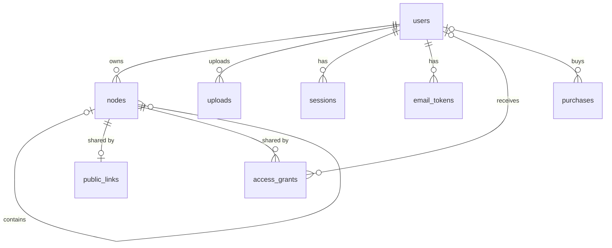
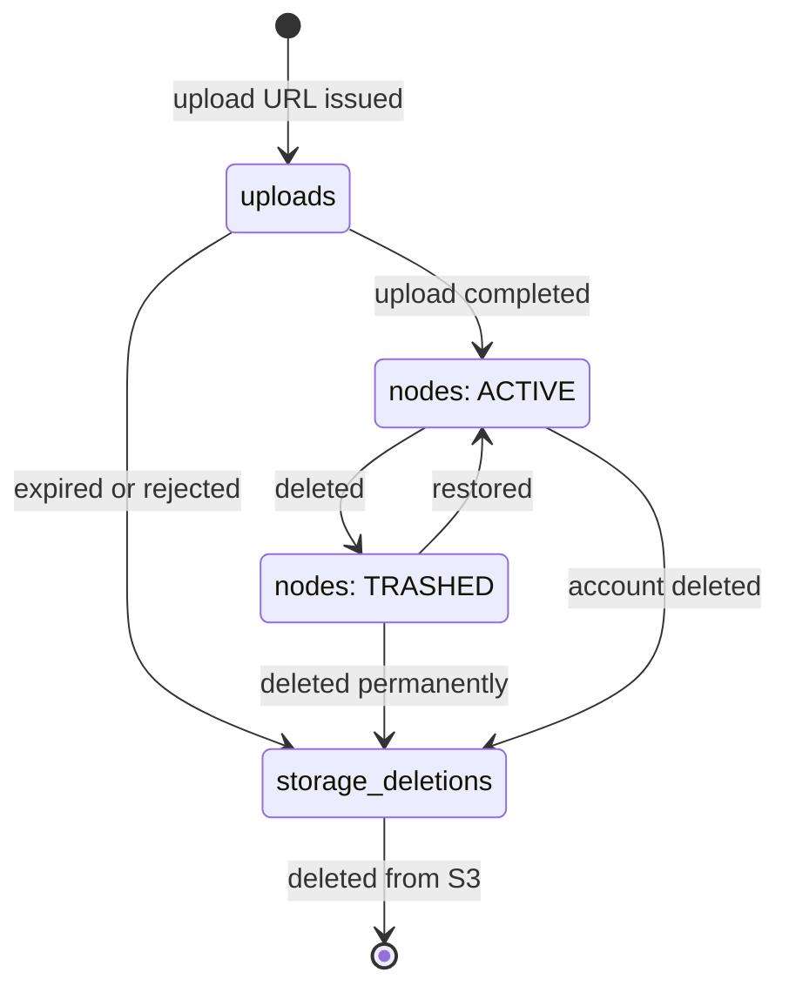

# Database

PostgreSQL 18. The schema is changed only by Flyway migrations. This document describes the tables and the reasons for the main decisions. Business rules are in [functional.md](functional.md), limits in [limits.md](limits.md).

## Conventions

- Names are `snake_case`, table names are plural.
- Columns are `NOT NULL` unless marked `null` in the tables below.
- Entities visible in the API have `uuid` primary keys, generated in the application as UUIDv7. A v7 UUID starts with a timestamp, so new rows go to the end of the index instead of random pages. Internal append-only tables (`activity_log`, `storage_deletions`) use `bigint generated always as identity`.
- Time is `timestamptz`. Sizes are `bigint` bytes. Money is `bigint` kopecks.
- Enumerations are `text` with a `CHECK` constraint, not PostgreSQL `enum` types. Values are easier to change in migrations, and they map directly to `@Enumerated(EnumType.STRING)`.
- The database enforces structural rules: `NOT NULL`, foreign keys, uniqueness, consistency between columns. Configurable limits from limits.md (lengths, counts, durations) are checked only in the application, so changing them does not need a migration.
- Constraints and indexes have explicit names with prefixes `pk_`, `fk_`, `uq_`, `ck_`, `ix_`. The application maps the name of a violated constraint to a business error, for example `uq_nodes_parent_name` to a name conflict.
- Every foreign key column used for lookups or cascades has an index. PostgreSQL does not create these indexes automatically.
- Emails are stored trimmed and lowercased. File and folder names are normalized to Unicode NFC before saving: macOS sends some letters (for example `й`) in a decomposed form, which would otherwise give two different names that look the same.

### Locale

The cluster is created with the builtin locale provider (`--locale-provider=builtin --builtin-locale=C.UTF-8`). With it, `lower()` works for all Unicode letters, and text indexes do not depend on the OS C library. With a libc locale, an OS upgrade can change the sort order and silently break indexes on text columns.

Sorting by name for display uses an ICU collation in the query: `ORDER BY name COLLATE "und-x-icu"`. A folder has at most 1,000 objects, so this sort does not need an index.

## Overview

Tables without foreign keys: `email_blacklist`, `storage_deletions`, `activity_log`.

| Module | Tables |
|---|---|
| auth | `users`, `email_blacklist`, `email_tokens`, `sessions` |
| files | `nodes`, `uploads`, `storage_deletions` |
| sharing | `public_links`, `access_grants` |
| billing | `purchases` |
| common | `activity_log` |

## Tables

### users

| Column | Type | Notes |
|---|---|---|
| `id` | `uuid` | PK |
| `email` | `text` | unique |
| `nickname` | `text` | original case, for display |
| `password_hash` | `text` | Argon2id |
| `role` | `text` | `USER`, `ADMIN`; default `USER` |
| `locale` | `text` | `ru`, `en`; default `ru` |
| `email_confirmed_at` | `timestamptz` null | null means not confirmed |
| `blocked_until` | `timestamptz` null | |
| `block_reason` | `text` null | |
| `base_quota_bytes` | `bigint` | free quota; copied from configuration at registration, changed by an admin |
| `used_bytes` | `bigint` | sum of `nodes.size_bytes` of the user; default 0 |
| `created_at` | `timestamptz` | |
| `updated_at` | `timestamptz` | |

- `uq_users_email` on `email`.
- `uq_users_nickname`: unique index on `lower(nickname)`. Nicknames are case-insensitive.
- `ck_users_block`: `blocked_until` and `block_reason` are both set or both null.
- `ck_users_quota`: `base_quota_bytes >= 0`, `used_bytes >= 0`.
- `ix_users_unconfirmed` on `created_at` where `email_confirmed_at is null`, for the cleanup job.

There is no status column. The state is derived from the columns, and states can overlap: an account can be unconfirmed and blocked at the same time. A user is blocked while `blocked_until > now()`, so a block ends by itself without a job.

### email_blacklist

| Column | Type | Notes |
|---|---|---|
| `email` | `text` | PK |
| `reason` | `text` | |
| `created_by` | `uuid` | admin; no FK, the record outlives the admin account |
| `created_at` | `timestamptz` | |

### email_tokens

| Column | Type | Notes |
|---|---|---|
| `id` | `uuid` | PK |
| `user_id` | `uuid` | FK `users`, on delete cascade |
| `type` | `text` | `EMAIL_CONFIRMATION`, `PASSWORD_RESET`, `PASSWORD_CHANGE`, `EMAIL_CHANGE`, `ACCOUNT_DELETION` |
| `token_hash` | `bytea` | SHA-256 of the token from the email |
| `new_email` | `text` null | only for `EMAIL_CHANGE` |
| `new_password_hash` | `text` null | only for `PASSWORD_CHANGE` |
| `expires_at` | `timestamptz` | |
| `created_at` | `timestamptz` | |

- `uq_email_tokens_hash` on `token_hash`.
- `uq_email_tokens_user_type` on `(user_id, type)`. A new token of the same type replaces the previous one (`INSERT ... ON CONFLICT (user_id, type) DO UPDATE`).
- `ck_email_tokens_payload`: `new_email` is set only for `EMAIL_CHANGE`, `new_password_hash` only for `PASSWORD_CHANGE`.

A password change takes effect only after the user follows the link, so the new password hash waits in the token row. A used token is deleted.

### sessions

| Column | Type | Notes |
|---|---|---|
| `id` | `uuid` | PK; identifies the session in the device list API |
| `user_id` | `uuid` | FK `users`, on delete cascade |
| `token_hash` | `bytea` | SHA-256 of the session token from the cookie |
| `ip` | `inet` | IP of the last activity |
| `user_agent` | `text` | raw header, cut to a maximum length by the application |
| `created_at` | `timestamptz` | |
| `last_seen_at` | `timestamptz` | |
| `expires_at` | `timestamptz` | |

- `uq_sessions_token_hash` on `token_hash`.
- `ix_sessions_user` on `user_id`: device list, sign out on all devices.
- `ix_sessions_expires` on `expires_at`, for the cleanup job.

The cookie holds a random 256-bit token. Only its hash is stored, so a database dump does not give working sessions.

A session stores only the user. Role, block and email confirmation are read from `users` on every request, so a change takes effect immediately.

`expires_at = min(last_seen_at + idle lifetime, created_at + absolute lifetime)`. A session is valid while `expires_at > now()`. `last_seen_at`, `ip` and `expires_at` are updated at most once per interval from limits.md, not on every request, to avoid a write per request.

Signing out deletes the row. Signing out on all devices deletes all rows of the user.

### nodes

Files and folders.

| Column | Type | Notes |
|---|---|---|
| `id` | `uuid` | PK |
| `owner_id` | `uuid` | FK `users`, on delete cascade |
| `parent_id` | `uuid` null | parent folder; null for the root and for top-level objects in the trash |
| `type` | `text` | `FOLDER`, `FILE` |
| `name` | `text` | empty for the root |
| `size_bytes` | `bigint` null | files only |
| `content_type` | `text` null | files only; MIME type, used for preview |
| `storage_key` | `text` null | files only; object key in S3 |
| `status` | `text` | `ACTIVE`, `TRASHED`; default `ACTIVE` |
| `trashed_at` | `timestamptz` null | only on the object the user deleted, not on its contents |
| `trashed_from_id` | `uuid` null | folder of that object before deletion |
| `created_at` | `timestamptz` | |
| `updated_at` | `timestamptz` | modification date shown in the UI |

- `uq_nodes_id_owner` on `(id, owner_id)`, needed for the next key.
- `fk_nodes_parent`: `(parent_id, owner_id)` references `nodes (id, owner_id)`. The parent always belongs to the same owner, so a bug cannot put an object into another user's folder.
- `fk_nodes_trashed_from`: `trashed_from_id` references `nodes (id)`, on delete set null.
- `uq_nodes_parent_name`: unique index on `(parent_id, lower(name))`. Also used to list a folder.
- `uq_nodes_root`: unique index on `owner_id` where `parent_id is null and trashed_at is null`. One root per user.
- `uq_nodes_storage_key` on `storage_key`.
- `ck_nodes_type`: a file has `size_bytes >= 0`, `content_type` and `storage_key`; a folder has none of them.
- `ck_nodes_root`: an object without a parent outside the trash is a folder with an empty name.
- `ck_nodes_name`: only the root has an empty name.
- `ck_nodes_trash`: `trashed_at` is set only when `parent_id is null` and `status = 'TRASHED'`; `trashed_from_id` is set only when `trashed_at` is set.
- `ix_nodes_owner` on `owner_id`: search, account deletion.
- `ix_nodes_trash` on `(owner_id, trashed_at)` where `trashed_at is not null`: trash list, trash retention.
- `ix_nodes_trashed_from` on `trashed_from_id` where `trashed_from_id is not null`.
- `ix_nodes_recent_files` on `created_at` where `type = 'FILE'`: recent uploads in the admin panel.

`storage_key` is a random UUID, separate from `id`. The key format can change later (for example, get a prefix) without changing IDs.

### uploads

Uploads that are not completed yet. A row is also the quota reservation for the upload.

| Column | Type | Notes |
|---|---|---|
| `id` | `uuid` | PK; upload ID in the API |
| `owner_id` | `uuid` | FK `users`, on delete cascade |
| `parent_id` | `uuid` null | target folder; FK `nodes`, on delete set null |
| `name` | `text` | requested name; the final name is chosen on completion |
| `size_bytes` | `bigint` | declared size |
| `content_type` | `text` | |
| `storage_key` | `text` | |
| `expires_at` | `timestamptz` | after it, the upload is removed |
| `created_at` | `timestamptz` | |

- `uq_uploads_storage_key` on `storage_key`.
- `ix_uploads_owner` on `owner_id`, `ix_uploads_parent` on `parent_id`, `ix_uploads_expires` on `expires_at`.

### storage_deletions

Queue of S3 objects to delete. See [Deleting files from storage](#deleting-files-from-storage).

| Column | Type | Notes |
|---|---|---|
| `id` | `bigint` | PK, identity |
| `storage_key` | `text` | |
| `size_bytes` | `bigint` | counted in the service-wide storage limit until the object is deleted |
| `attempts` | `integer` | default 0 |
| `next_attempt_at` | `timestamptz` | default `now()` |
| `last_error` | `text` null | |
| `created_at` | `timestamptz` | |

- `uq_storage_deletions_key` on `storage_key`.
- `ix_storage_deletions_next` on `next_attempt_at`.

### public_links

| Column | Type | Notes |
|---|---|---|
| `id` | `uuid` | PK |
| `node_id` | `uuid` | FK `nodes`, on delete cascade |
| `token` | `text` | random 256 bits, base64url; `{token}` in `/s/{token}` |
| `created_at` | `timestamptz` | |

- `uq_public_links_node` on `node_id`: one link per object.
- `uq_public_links_token` on `token`.

The token is stored as is, not as a hash: the owner must be able to see and copy the link again. It gives read access to one object only. Disabling a link deletes the row, so a new link always gets a new token.

### access_grants

| Column | Type | Notes |
|---|---|---|
| `id` | `uuid` | PK |
| `node_id` | `uuid` | FK `nodes`, on delete cascade |
| `grantee_id` | `uuid` null | FK `users`, on delete cascade |
| `grantee_email` | `text` null | email without a confirmed account |
| `expires_at` | `timestamptz` null | only with `grantee_email` |
| `created_at` | `timestamptz` | date shown in "Shared with me" |

- `ck_access_grants_grantee`: either `grantee_id`, or `grantee_email` with `expires_at`.
- `uq_access_grants_node_user` on `(node_id, grantee_id)`.
- `uq_access_grants_node_email` on `(node_id, grantee_email)`.
- `ix_access_grants_grantee` on `grantee_id`.
- `ix_access_grants_email` on `grantee_email` where `grantee_email is not null`.
- `ix_access_grants_expires` on `expires_at` where `expires_at is not null`.

Access by email to a confirmed account is stored with `grantee_id` at once. Otherwise the row waits with `grantee_email`. When a user confirms an email (at registration or on email change), waiting rows for it get `grantee_id`, and `grantee_email` and `expires_at` become null. If the user already has access to the same object, the waiting row is deleted.

### purchases

| Column | Type | Notes |
|---|---|---|
| `id` | `uuid` | PK |
| `user_id` | `uuid` null | FK `users`, on delete set null |
| `plan_code` | `text` | plan from configuration |
| `size_bytes` | `bigint` | copy of the plan at purchase time |
| `duration_days` | `integer` | copy of the plan |
| `amount_kopecks` | `bigint` | copy of the plan |
| `status` | `text` | `PENDING`, `PAID`, `CANCELED` |
| `provider` | `text` | `STUB`, later the real provider |
| `provider_payment_id` | `text` null | payment ID at the provider; set when the payment is created |
| `paid_at` | `timestamptz` null | |
| `starts_at` | `timestamptz` null | set on payment |
| `ends_at` | `timestamptz` null | set on payment |
| `reminder_sent_at` | `timestamptz` null | expiry reminder sent |
| `created_at` | `timestamptz` | |
| `updated_at` | `timestamptz` | |

- `uq_purchases_provider_payment` on `(provider, provider_payment_id)`.
- `ck_purchases_paid`: `paid_at`, `starts_at`, `ends_at` are set exactly when `status = 'PAID'`, and `ends_at > starts_at`.
- `ix_purchases_user` on `(user_id, ends_at)`: active plans of a user.
- `ix_purchases_reminders` on `ends_at` where `status = 'PAID' and reminder_sent_at is null`.

Plans live in configuration, and a purchase keeps a copy of the plan: changing a plan does not change purchases already made.

Purchases are kept after account deletion, as payment records are in a real service. `user_id` becomes null, so the record no longer points to a person.

A payment notification is applied with `UPDATE ... SET status = 'PAID' ... WHERE id = ? AND status = 'PENDING'`, after the status is checked with the provider's API. If no row is updated, the notification was already handled, so a repeated notification does not add space twice.

Renewal rules are not defined yet. The schema allows several purchases of the same plan with consecutive periods.

### activity_log

| Column | Type | Notes |
|---|---|---|
| `id` | `bigint` | PK, identity |
| `occurred_at` | `timestamptz` | default `now()` |
| `actor_id` | `uuid` null | who did it: the user or an admin; null for the system |
| `subject_user_id` | `uuid` null | whose account or files were affected |
| `action` | `text` | `SIGN_IN`, `FILE_UPLOADED`, `USER_BLOCKED`, ... |
| `node_id` | `uuid` null | |
| `ip` | `inet` null | |
| `details` | `jsonb` null | object name and path, size, block reason and similar |

- `ix_activity_log_subject` on `(subject_user_id, occurred_at)`.
- `ix_activity_log_time` on `occurred_at`: overall feed and retention.

There are no foreign keys, and the object name goes into `details`. Records must outlive deleted objects and accounts: an admin's "delete and blacklist" action must stay in the log. Rows are removed only by retention. The privacy policy must mention this.

`action` has no `CHECK`, unlike the other enumerations. The list grows with almost every feature and is controlled by a Java enum; a `CHECK` would need a migration for each new action.

If the log becomes large, it can be partitioned by month, so retention drops old partitions instead of deleting rows. Not needed now.

## Main decisions

### File tree

Files and folders are in one table. A name is unique within a folder across files and folders together, and with one table a single unique index guarantees it. Two concurrent requests cannot create the same name: the application inserts the row, catches `uq_nodes_parent_name` and retries with the next index (`report (1).pdf`).

The tree is an adjacency list: every object stores `parent_id`. Moving an object changes one column. The alternatives, a materialized path (the full path stored in each row) or a closure table (all ancestor and descendant pairs), make a move rewrite the whole subtree. Breadcrumbs, paths in search results, the check against moving a folder into its own subfolder and subtree operations use recursive queries (`WITH RECURSIVE`); the depth is at most 32, so they are cheap.

The root is a regular row without a parent. Every other object then has a parent, and the unique index needs no special case for the top level.

### Trash

When the user deletes an object:

- the object leaves the tree: `parent_id` becomes null, the old parent goes to `trashed_from_id`, `trashed_at` is set;
- the object and its whole subtree get `status = 'TRASHED'`.

Why the object leaves the tree: suppose file A is deleted from folder F, then F is deleted and permanently deleted from the trash. A is not in the subtree of F, so it stays in the trash. `trashed_from_id` becomes null, and A is restored to the root, as functional.md requires. Also, a new object with the same name can be created in F while A is in the trash; on restore, a name conflict gets an index.

Why the status is set on the whole subtree: search, "Shared with me" and access checks filter by `status = 'ACTIVE'` on the object itself and do not walk up the tree.

On restore, the target is `trashed_from_id` if that folder is active, otherwise the root. The object gets a free name in the target, its parent is set back, and the subtree becomes `ACTIVE` again.

### Uploads and quota

Uploads are a separate table, so `nodes` holds only real objects, and no query has to exclude unfinished uploads.

- **Upload URL issued.** One transaction: lock the user row, check the quota and the number of concurrent uploads, insert an `uploads` row. The row is the reservation.
- **Upload completed.** Check the object size in S3. Then one transaction: lock the user row, check that the target folder is still active, insert a `nodes` row with a free name, delete the `uploads` row, add the size to `used_bytes`. If a check fails, the `uploads` row is deleted and the key goes to `storage_deletions`.

Quota formulas:

- reserved = sum of `uploads.size_bytes` of the user (at most 3 rows);
- total quota = `base_quota_bytes` + sum of `size_bytes` of `PAID` purchases with `starts_at <= now() < ends_at`;
- an upload is allowed if `used_bytes + reserved + new size <= total quota`;
- the quota is exceeded if `used_bytes > total quota`.

The total quota and the quota-exceeded mode are not stored: they change with time when a plan ends.

`used_bytes` is a stored copy of `sum(nodes.size_bytes)`. Summing for every page (the quota bar is always visible) would cost more. It is changed in the same transaction as the `nodes` rows, and an integration test checks that it equals the sum.

The service-wide storage limit is checked when an upload URL is issued: `sum(users.used_bytes) + sum(uploads.size_bytes) + sum(storage_deletions.size_bytes)`. There is no global lock, so concurrent uploads can go over the limit by a few files. That is acceptable: the limit protects against an unexpected bill, it is not an exact quota.

### Locking

Every operation that changes a user's tree or quota first locks the user row: `SELECT ... FROM users WHERE id = ? FOR UPDATE`. Operations of one user run one after another; different users do not block each other.

This protects against:

- parallel uploads that together exceed the quota or the limit of concurrent uploads;
- going over 1,000 objects in a folder;
- a cycle from two parallel moves: "A into B" and "B into A" each pass the check alone, but together they create a cycle.

Name uniqueness is also guaranteed by the unique index.

### Deleting files from storage

S3 and PostgreSQL cannot share a transaction. So the transaction that deletes `nodes` or `uploads` rows also inserts their storage keys into `storage_deletions`. On commit, the rows are gone, the quota is freed and the keys are saved. On rollback, nothing changes. A key cannot be lost.

A background job takes due rows with `FOR UPDATE SKIP LOCKED`, deletes the objects from S3 and deletes the rows. S3 `DeleteObject` succeeds for a missing key, so a retry is safe. On error, the job increases `attempts`, moves `next_attempt_at` with a growing delay and saves `last_error`. The admin is alerted about rows with many attempts.

The trade-off: the quota is freed before the object is physically deleted. Deletion from S3 rarely fails, and stuck rows are visible to the admin.

The queue is used for permanent deletion, trash retention, account deletion and removed uploads.

### Account deletion

One transaction: lock the user row, insert the keys of all files and uploads of the user into `storage_deletions`, delete the `users` row. Cascades delete `nodes`, `uploads`, `sessions`, `email_tokens`, `access_grants` (received by the user and on the user's objects) and `public_links`. `purchases.user_id` becomes null, `activity_log` is not changed. The email and the nickname are free immediately.

The same procedure is used for deletion by the user, for unconfirmed accounts and for deletion by an admin. In the last case, the email is added to `email_blacklist` in the same transaction.

### Access checks

Access is checked on every request and is not copied to nested objects.

- **Owner:** `nodes.owner_id` is the current user.
- **Shared with a user:** walk up from the object by `parent_id`. Access is allowed if the object or one of its ancestors has an `access_grants` row for the user.
- **Public link:** the object is the link's object or one of its descendants.

In the last two cases, the object must be `ACTIVE` and its owner must not be blocked.

Because access is computed, moving an object out of a shared folder removes access through that folder, and a block of the owner needs no changes to the data. "Shared with me" hides a granted object if one of its ancestors is also shared with the same user.

## Background jobs

| Job | What it does |
|---|---|
| Unconfirmed accounts | deletes accounts not confirmed within the time limit (see Account deletion) |
| Trash retention | permanently deletes trash objects older than the retention period |
| Expired uploads | deletes `uploads` rows past `expires_at`, keys go to `storage_deletions` |
| Storage deletions | processes `storage_deletions` |
| Expired tokens | deletes `email_tokens` past `expires_at` |
| Expired sessions | deletes `sessions` past `expires_at` |
| Waiting access | deletes `access_grants` past `expires_at` |
| Plan reminders | sends reminders for plans ending soon, sets `reminder_sent_at` |
| Log retention | deletes `activity_log` rows older than the retention period |

The application runs as one instance. The queue job uses `SKIP LOCKED`, and the other jobs are idempotent, so running two instances at once would not break the data.

## Not stored in the database

- **Rate limits and failed sign-in counters:** in memory. The application runs as one instance, and losing the counters on restart is acceptable.
- **CSRF token:** in a cookie (`CookieCsrfTokenRepository`), because there is no server-side HTTP session to keep it in.
- **Theme:** in the browser. Only the language is saved in the account (ui.md).
- **Plans and limits:** in configuration.
- **File contents:** in S3.

Search uses `lower(name) LIKE '%...%'` filtered by `owner_id`. A trigram index (`pg_trgm`) will be added if search becomes slow.

## Migrations

- Files `V<n>__<description>.sql` in `backend/src/main/resources/db/migration`. An applied migration is never edited; a fix is a new migration.
- Hibernate runs with `ddl-auto: validate`: the application does not start if the entities do not match the schema.
- Integration tests run all migrations on a real PostgreSQL of the same version (Testcontainers).
- A change that is not backward compatible (renaming or removing a column) is done in steps: add the new column, fill it, switch the code, remove the old one in a later migration.
